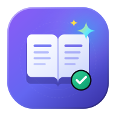
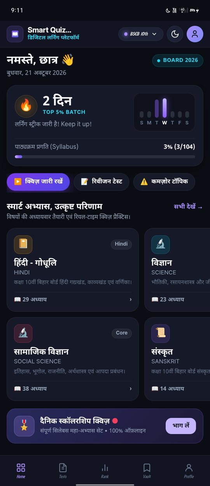
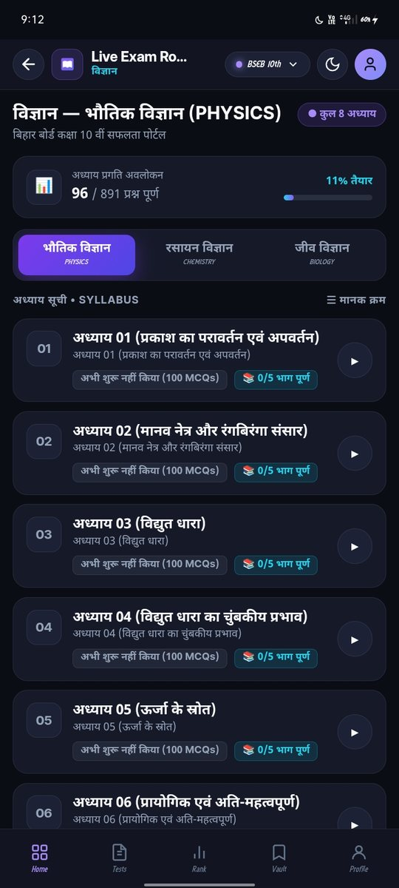
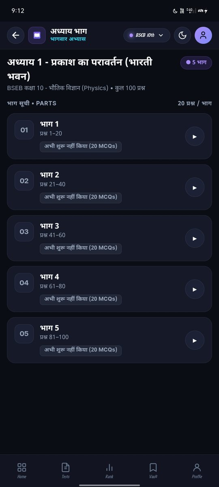
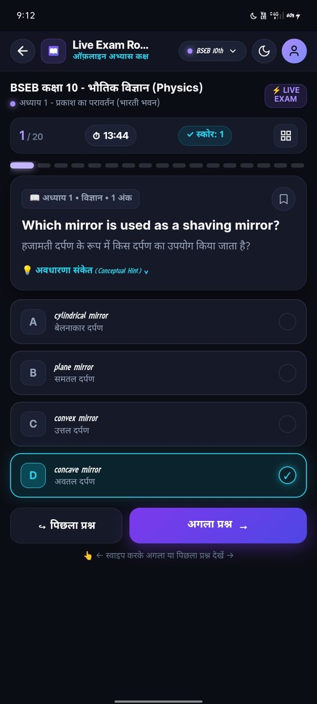
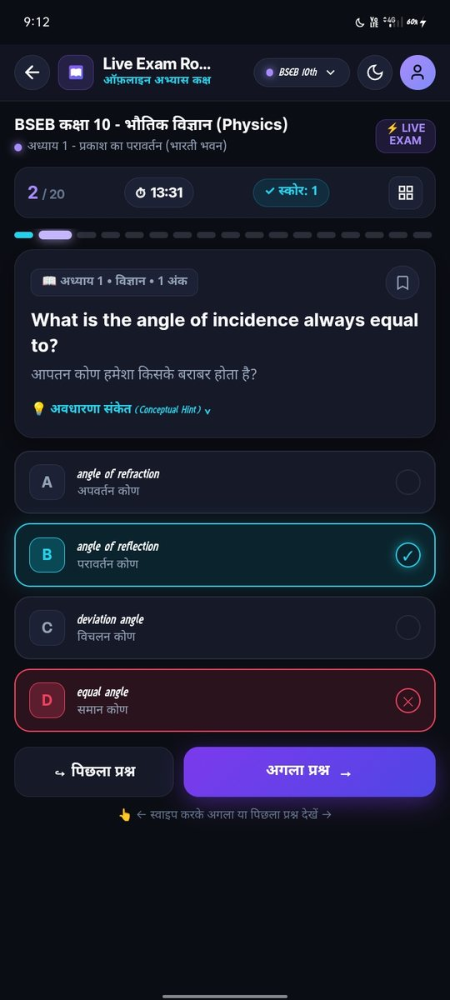
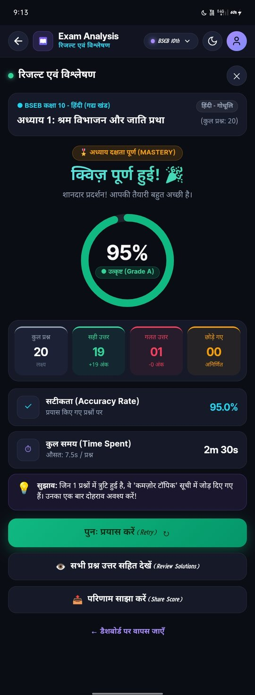
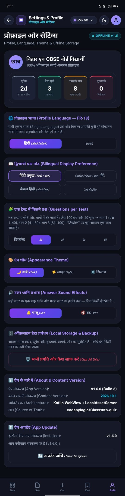

# Smart Quiz Portal — Android App

[](https://github.com/codebylogic/Class10th-quiz-android/actions/workflows/build-apk.yml)



A free, **offline-first** quiz app for **Bihar Board (BSEB)** and **CBSE** students of Class 9, 10 and 11 — chapter-wise multiple-choice practice in Hindi and English. Every question is bundled inside the app, so it works **with no internet at all**, even in airplane mode.

**7 tracks · 404 chapters · 33,112 MCQs · APK ≈ 8.8 MB**

---

## Screenshots

<table>
  <tr>
    <td align="center" width="33%">
      <br />
      <sub><b>Home</b> — streak, syllabus progress and every subject</sub>
    </td>
    <td align="center" width="33%">
      <br />
      <sub><b>Chapter list</b> — sections, progress and part badges</sub>
    </td>
    <td align="center" width="33%">
      <br />
      <sub><b>भाग सूची</b> — a long chapter split into smaller parts</sub>
    </td>
  </tr>
  <tr>
    <td align="center" width="33%">
      <br />
      <sub><b>Correct answer</b> — instant feedback, right option revealed</sub>
    </td>
    <td align="center" width="33%">
      <br />
      <sub><b>Wrong answer</b> — your mistake and the right answer together</sub>
    </td>
    <td align="center" width="33%">
      <br />
      <sub><b>Result</b> — score ring, accuracy, time and review</sub>
    </td>
  </tr>
  <tr>
    <td align="center" width="33%">
      <br />
      <sub><b>Settings</b> — language, questions per test, sounds and app update</sub>
    </td>
    <td></td>
    <td></td>
  </tr>
</table>

---

## What it is

Students preparing for board exams need to practise objective questions chapter by chapter. Most quiz apps need a good internet connection, ask for a login, and are full of ads. This app is the opposite: install it once and it keeps working — on a shared phone, on a slow connection, or with no connection.

The whole syllabus is inside the app:

| Track | Subjects |
| :--- | :--- |
| **BSEB 10th** | Hindi (गद्यखंड · काव्यखंड · वर्णिका), Science (Physics · Chemistry · Biology), Social Science (History · Geography · Political Science · Economics · Disaster Management), Sanskrit |
| **BSEB 11th** | Physics, Chemistry, Biology |
| **BSEB 9th** | Science, Social Science |
| **CBSE 10th** | Science, English (First Flight · Footprints), Hindi (Kshitij · Kritika), Social Science |
| **CBSE 9th** | Science, Social Science |
| **Common GK** | History, Geography, Polity, Economics, Physics, Chemistry, Biology, Static GK, Current Affairs |
| **Common Grammar** | Hindi Grammar, English Grammar |

---

## What it does

**Study offline, always.** All questions, answers, fonts and sounds are stored inside the app. No login, no ads, no data leaves the phone.

**Chapter-wise quizzes.** Pick your board and class, choose a subject, then a chapter. Every quiz shuffles both the questions and the answer options, so you never memorise positions.

**Instant feedback.** Tap an answer and you immediately see whether it is right or wrong — with a sound. The correct option is always revealed, so you learn even when you get it wrong.

**Question navigator.** A grid of all questions in the quiz, colour-coded by state (answered right, wrong, skipped, or still left). Jump to any question at any time.

**Clear results.** A scorecard with a percentage ring, total/correct/wrong/skipped counts, accuracy and time taken, a motivational message, and a full solution review.

**Study in smaller parts.** For long chapters you can set how many questions you want in one test — 20, 30, 40 or 50 — and the chapter splits into parts. See the section below.

**Remembers your progress.** Every attempt is saved on the phone: best score, last score, number of attempts, a real daily streak, a weak-topic list of questions you get wrong often, and bookmarks for revision.

**Hindi and English.** The whole interface is available in Hindi and English, and bilingual questions can be shown in either order — or in one language only.

**A proper launch.** A short opening animation plays when the app starts — a book page turns, a quiz question appears and a hand taps the correct answer. Tap anywhere to skip it.

**Tells you when there is a new version.** The app checks GitHub for the latest release and, if a newer version exists, shows a banner on the Home screen and a download button in Settings.

---

## How to use it (for students)

1. **Open the app.** From the top bar, choose your class and board — for example *BSEB 10th* or *CBSE 10th*. You can switch any time.
2. **Pick a subject.** You will see subject cards; tap the one you want to study.
3. **Pick a section, then a chapter.** Some subjects are grouped into sections (Physics / Chemistry / Biology, or गद्यखंड / काव्यखंड / वर्णिका). Tap a section to see its chapters.
4. **Tap a chapter.** A short intro appears with the number of questions, the estimated time and the total marks. If the chapter is bilingual, choose your language preference here.
5. **Press "क्विज़ शुरू करें".** Answer the questions one by one. You can skip a question, swipe left or right to move between questions, or open the navigator grid.
6. **Finish.** You will see your score and can review every question. Press retry to attempt it again — the questions and options will be shuffled fresh.
7. **Settings.** Open the profile screen to change the theme, the profile language, the number of questions per test, or to turn the answer sounds on and off. There is also a *Clear all data* option.

Your progress is saved automatically on the phone. Nothing is uploaded anywhere.

---

## Parts — study a chapter in smaller chunks

A 100-question quiz in one sitting is hard. So the app can break a chapter into parts.

Go to **Settings → 🧩 एक टेस्ट में कितने प्रश्न (Questions per Test)** and choose **20, 30, 40 or 50** (or leave it on **डिफ़ॉल्ट**).

Once a size is chosen, every chapter behaves like a folder. Tapping a chapter opens its list of parts instead of the quiz:

| Chapter | Setting | Parts |
| :--- | :--- | :--- |
| 100 questions | 40 | भाग 1 (1–40) · भाग 2 (41–80) · भाग 3 (81–100) |
| 100 questions | 30 | भाग 1 (1–30) · भाग 2 (31–60) · भाग 3 (61–100) |
| 100 questions | 20 | five parts of 20 |
| 199 questions | 40 | five parts (40, 40, 40, 40, 39) |

Each part is a complete quiz of its own: it shuffles internally, is scored separately, saves its own progress, and can be resumed independently. The chapter row shows how far you have got, for example **"📚 2/5 भाग पूर्ण"**.

Parts are always taken in the chapter's original order, so *भाग 2* always means the same questions. A trailing part that would be very small is merged into the previous one, so you never get a sad little 10-question part at the end.

On **डिफ़ॉल्ट**, nothing changes — a chapter goes straight into a full quiz, as before. Chapters with few questions also skip the parts screen automatically.

---

## Installing the app

The app is not on the Play Store. Install it directly:

1. Download the latest **APK** from the [Releases](https://github.com/codebylogic/Class10th-quiz-android/releases) page.
2. On the phone, open **Settings → Apps → Special access → Install unknown apps** and allow it for the app you are using to open the file (Files, Chrome, WhatsApp, etc.).
3. Tap the downloaded APK → **Install** → **Open**.

**Requirements:** Android 7.0 or newer. After installing, the app needs no internet — you can put the phone in airplane mode and it will still work.

---

## Updating the app

There are two ways, and both keep your progress, streak and bookmarks.

**From inside the app (recommended).** The app checks GitHub for the latest release when it starts. If a newer version exists you will see a banner on the Home screen and a card in **Settings → ⬆️ ऐप अपडेट** with a download button. Tapping it opens the download, and the new version installs straight over the old one.

**Manually.** Download the newest APK from the Releases page and install it — it replaces the old version without touching your data.

Because every build is signed with the **same signing key**, Android accepts a new APK as an update to the installed app. You never have to uninstall first.

---

## For developers

### How it is built

This is a **WebView hybrid** app, not a fully native UI:

- **Kotlin shell** (`MainActivity`, `AppPrefs`, and `web/WebViewHost`, `LocalAssetServer`, `NativeBridge`, `BackHandler`) — opens a full-screen WebView, serves the web files over a local origin, handles the back button and the splash screen, and exposes a tiny JavaScript bridge (vibrate, share, toast, open an external URL, version, exit).
- **Web layer** (`assets/web/` — HTML, CSS and plain JavaScript) — every screen, the quiz engine, the parts feature, the launch animation, storage, the update checker and the settings screen.
- **Content** (`assets/web/data/` — 404 JSON files, plus `assets/web/catalog.json`) — bundled and read locally, so nothing is ever downloaded.
- **Fonts** (`assets/web/fonts/` — Mukta, Inter, Space Grotesk), **sounds** (`assets/web/sounds/`) and **icons** (`res/mipmap-*`) are bundled too, so text and audio work offline.

Serving the files from `https://appassets.androidplatform.net/` (instead of `file://`) means `fetch()`, `localStorage` and `IndexedDB` all behave normally — which is what lets the app keep working with no network.

### Project structure

```
app/src/main/
  java/com/smartquiz/portal/
    MainActivity.kt              hosts the WebView, applies the splash theme
    AppPrefs.kt                  DataStore-backed preferences and progress snapshot
    web/WebViewHost.kt           WebView configuration and local-origin lock
    web/LocalAssetServer.kt      serves assets/web/ over the local origin
    web/NativeBridge.kt          the JavaScript bridge
    web/BackHandler.kt           hardware back button
  assets/web/
    index.html                   app shell, launch intro and router
    css/theme.css                design tokens, dark and light themes
    css/intro.css                launch animation
    js/app.js                    screens and routing
    js/quiz.js                   quiz engine (shuffle, scoring, result bands, parts)
    js/catalog.js                catalogue and chapter loading
    js/storage.js                progress, streak, bookmarks, settings
    js/translate.js              profile-language translation
    js/lang-detect.js            Hindi / English detection
    js/settings.js               profile and settings screen
    js/sfx.js                    answer and tap sound effects
    js/updater.js                in-app update checker
    js/intro.js                  launch animation driver
    sounds/                      click.webm, correct.m4a, wrong.m4a
    fonts/                       Mukta, Inter, Space Grotesk
    catalog.json                 the catalogue of all chapters
    data/                        the 404 chapter JSON files
  res/mipmap-*/                  launcher icons (legacy + adaptive layers)
screenshots/                     images used by this README
scripts/
  validate_content.py            checks every chapter file and catalogue entry
  sync_from_pwa_repo.py          copies + repairs chapter files from the content repo
.github/workflows/build-apk.yml  builds the debug APK on every push
```

### Building it yourself

1. Open the project folder in **Android Studio** (Ladybug or newer), or from a terminal with **JDK 17** and **Gradle 9.3.1** installed:

   ```bash
   gradle :app:assembleDebug
   ```

2. The APK appears at `app/build/outputs/apk/debug/app-debug.apk`.
3. Every build first runs the `validateQuizContent` Gradle task, which checks that the catalogue is valid and that every chapter file exists and parses — so a broken content file fails the build instead of reaching the user.

Pushing to `main` runs the GitHub Actions workflow, which builds the APK and uploads it as a downloadable artifact.

### Content

The quiz content lives in a separate repository — [codebylogic/Class10th-quiz](https://github.com/codebylogic/Class10th-quiz) — and is copied into `assets/web/data/`:

```bash
python3 scripts/sync_from_pwa_repo.py /path/to/Class10th-quiz
```

That script also repairs the two known damaged chapter files (`PHYSICS/mega.json`, `BIOLOGY/mega.json`) while copying, and then runs the validator.

### Signing

The app is signed with a **fixed keystore** that is stored in this repository's GitHub Secrets (`SIGNING_KEYSTORE_BASE64`, `SIGNING_STORE_PASSWORD`, `SIGNING_KEY_ALIAS`, `SIGNING_KEY_PASSWORD`). The workflow decodes it before building and prints the signing certificate afterwards.

Because the key never changes, every APK can be installed over the previous one — which is what makes the in-app update work. If the secrets are ever lost, updates can no longer be installed in place.

If the secrets are missing (for example on a local machine), the build falls back to a temporary debug keystore so nothing breaks — but APKs signed that way cannot update an existing install.

---

## Version history

| Version | Highlights |
| :--- | :--- |
| **v1.6.0** | New app icon, launch intro animation |
| **v1.5.1** | Fixed signing key — updates now install straight over the old version |
| **v1.5.0** | In-app update checker, tap sound effect (vibration removed) |
| **v1.3.0** | Parts — split long chapters into smaller tests |
| **v1.2.0** | Real audio files for the answer sounds |
| **v1.1.0** | Correct / wrong answer sound effects |
| **v1.0** | First release — offline chapter-wise quizzes for BSEB & CBSE |
